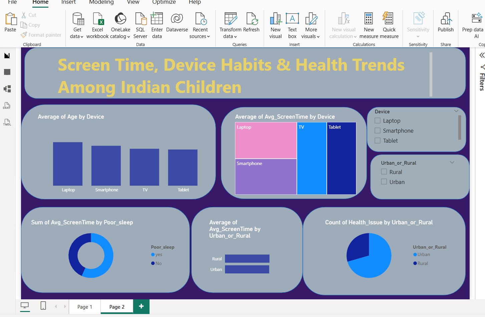

# Screen Time, Device Habits & Health Trends Among Indian Children

## Project Overview
An interactive Power BI dashboard analysing screen-time patterns, device usage and reported health trends among children in India.

## Tools & Technologies
- Power BI
- Power Query
- DAX
- Excel

## Key Analysis
- Screen time by age group
- Device usage patterns
- Urban vs Rural comparison
- Sleep duration analysis
- Reported health trends
- Interactive demographic filtering

## Power BI Skills Demonstrated
- Data cleaning and transformation
- Data modelling
- DAX measures
- KPI cards and charts
- Slicers and interactive dashboards
- Data visualisation and storytelling

## Project Status
Completed
## Dashboard Preview

