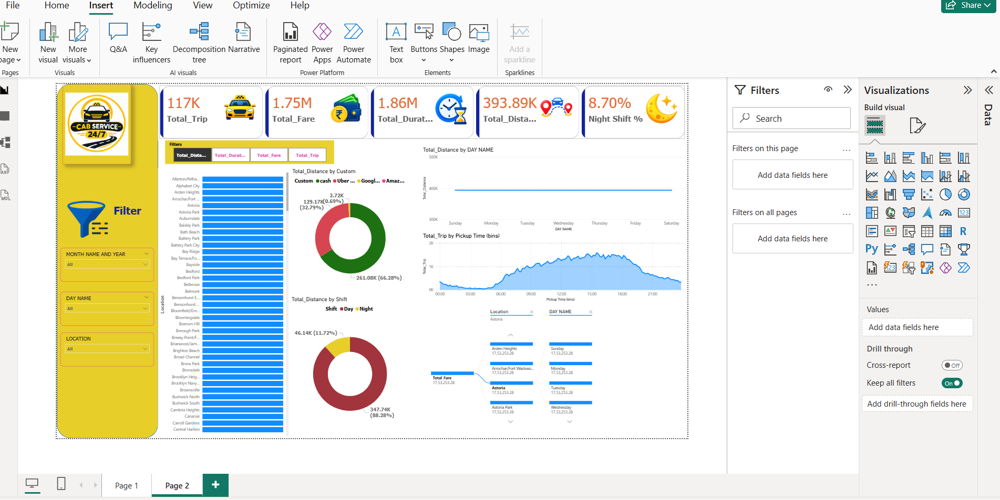

# Cab service 

## Project Overview
An interactive Power BI dashboard analysing cab service.

## Tools & Technologies
- Power BI
- Power Query
- DAX
- Excel

## Key Analysis
- Total Trip
- Total Fare
- Total Duration
- total Distance 
- Night Shift %
- Interactive State filtering

## Power BI Skills Demonstrated
- Data cleaning and transformation
- Data modelling
- DAX measures
- KPI cards and charts
- Slicers and interactive dashboards
- Data visualisation and storytelling

## Project Status
Completed

## Dashboard Preview

